<div align="center">


# Lectiomizer

**Et hurtigt og moderne Lectio: dit skema, dine opgaver, beskeder og karakterer samlet ét sted.**

En udvidelse til Firefox og Chrome, der åbner sin egen app med det Lectio-login, du allerede har.

[](https://github.com/Turtlezztz/lectiomizer-extension/releases/latest)
[](https://github.com/Turtlezztz/lectiomizer-extension/releases)
[](https://github.com/Turtlezztz/lectiomizer-extension/releases/latest)
[](https://github.com/Turtlezztz/lectiomizer-extension/commits/main)
[](https://github.com/Turtlezztz/lectiomizer-extension/graphs/commit-activity)

[](https://github.com/Turtlezztz/lectiomizer-extension/releases/latest)
[](https://chromewebstore.google.com/detail/lectiomizer/bcjodfpidkofibnfmdobgdmgdelekhdc)
[](https://www.typescriptlang.org/)
[](https://react.dev/)
[](https://wxt.dev/)
[](https://tailwindcss.com/)
[](tests)

[**Download**](https://github.com/Turtlezztz/lectiomizer-extension/releases/latest) ·
[**Chrome Web Store**](https://chromewebstore.google.com/detail/lectiomizer/bcjodfpidkofibnfmdobgdmgdelekhdc) ·
[Funktioner](#funktioner) ·
[Skærmbilleder](#skærmbilleder) ·
[Privatliv](#privatliv) ·
[Udvikling](#udvikling) ·
[Arkitektur](docs/ARCHITECTURE.md)

<br>

<picture>
  <source media="(prefers-color-scheme: dark)" srcset="docs/screenshots/overview-dark.png">
  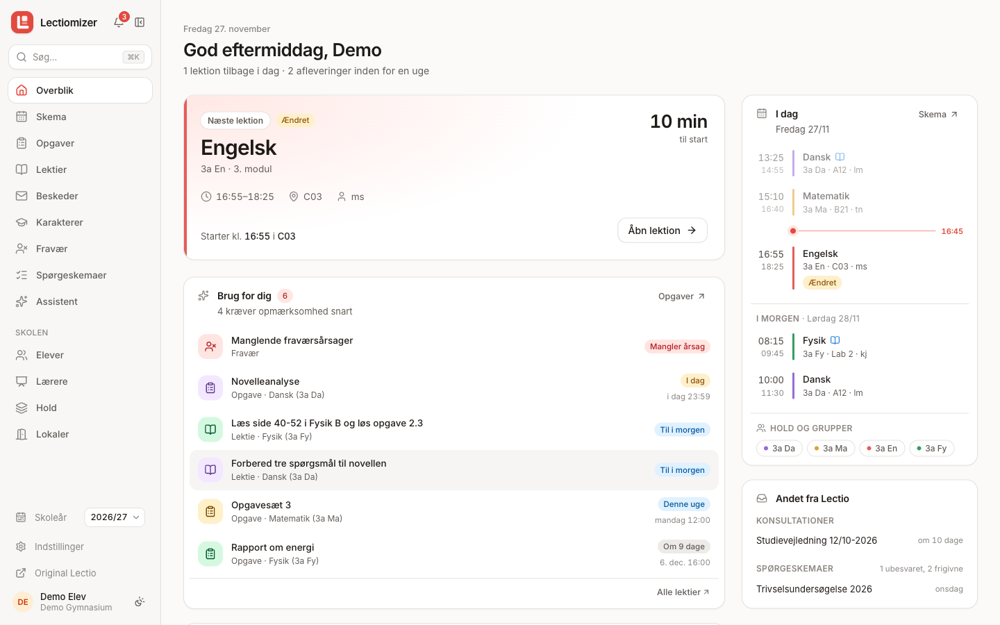
</picture>

<sub>Alle skærmbilleder er taget med opdigtede demodata.</sub>

</div>

---

## Hvorfor Lectiomizer?

Lectiomizer ændrer ikke udseendet på Lectios egne sider. Den åbner sin **egen app** i en fane og henter dit
skema, dine opgaver, beskeder, karakterer og dit fravær fra Lectio med det login, du allerede har. Ingen ny
konto, ingen server imellem, og handlinger (afsendelse, upload, aflevering) sker ved at indsende Lectios egne
formularer.

<table>
  <tr>
    <td align="center" width="25%">⚡<br><b>Hurtig</b><br><sub>Data caches og genbruges mellem sider</sub></td>
    <td align="center" width="25%">🔔<br><b>Notifikationer</b><br><sub>Ændrede moduler, nye beskeder og opgaver</sub></td>
    <td align="center" width="25%">🔒<br><b>Privat</b><br><sub>Intet sendes til en server, vi ejer</sub></td>
    <td align="center" width="25%">🌗<br><b>Lyst og mørkt</b><br><sub>Følger systemet eller dit valg</sub></td>
  </tr>
</table>

## Installation

| Browser | Sådan gør du |
| --- | --- |
|  | Hent `.xpi`-filen fra [seneste udgivelse](https://github.com/Turtlezztz/lectiomizer-extension/releases/latest), og åbn den i Firefox. Den er signeret af Mozilla og opdaterer sig selv. |
|  | Installér fra [Chrome Web Store](https://chromewebstore.google.com/detail/lectiomizer/bcjodfpidkofibnfmdobgdmgdelekhdc) med ét klik, eller hent `.zip`-filen fra [seneste udgivelse](https://github.com/Turtlezztz/lectiomizer-extension/releases/latest) og indlæs den upakket. |

> [!NOTE]
> Versionen i Chrome Web Store er altid bagud i forhold til GitHub Releases, fordi Googles gennemgang af hver
> opdatering tager lang tid. Vil du have den nyeste version med det samme, så hent den fra GitHub Releases.

**Kom i gang:** klik på knappen i værktøjslinjen, vælg din skole, og log ind på Lectio i den fane, der åbner.
Du kommer automatisk tilbage til appen bagefter.

## Funktioner

| | Funktion | Hvad den gør |
| --- | --- | --- |
| 🏠 | **Overblik** | Det nuværende eller næste modul med nedtælling, dagens moduler, kommende afleveringer, de nyeste beskeder og aktuelt. |
| 📅 | **Skema** | En ugekalender med farver pr. fag, ændrede og aflyste moduler og en levende "nu"-linje. På mobil vises en dagsoversigt. |
| 📝 | **Opgaver** | Kommende, manglende og afleverede opgaver, med aflevering, upload og grupper på opgavesiden. |
| 📚 | **Lektier** | Alle kommende moduler med lektier samlet på én side, dag for dag, med hele lektieteksten og modulets note. |
| ✉️ | **Beskeder** | En indbakke som i et mailprogram, med samtaletråde, svar og nye beskeder. |
| 📋 | **Spørgeskemaer** | Besvar spørgeskemaer (ét valg, flere valg og fritekst), gem en kladde eller aflever. |
| 🎓 | **Karakterer** | Standpunkter, årskarakterer, eksamenssnit med og uden bonus og en fordeling af dine karakterer. |
| 🩺 | **Fravær** og **Lektion** | Fravær og fraværsårsager; lektionsnoter, lektier og materialer for hvert modul. |
| 🗓️ | **Skoleår** | Skift til et tidligere skoleår og se dets skema, opgaver, karakterer, fravær, dokumenter og hold. |
| 🏫 | **Skolen** | Find elever, lærere, hold og lokaler og se deres skema. Hvert hold viser sit ugeskema, lærere og elever. |
| 💬 | **Elevfeedback** | Læs feedback fra lærer og klassekammerater, og skriv dit eget svar i en fuld editor med formatering, tabeller, billeder og filer. |
| 🔔 | **Notifikationer** | Tjekker Lectio i baggrunden (som standard hver time, ned til hvert 3. minut) og giver besked om ændrede, aflyste og genoprettede moduler, nye beskeder og nye opgaver. |
| ✨ | **Assistent** <sub>valgfri</sub> | Spørg om dit skema, dine opgaver, beskeder, karakterer og fravær. Svarer med dit eget ChatGPT-abonnement og kan kun læse. |
| 🔌 | **MCP-server** <sub>valgfri</sub> | De samme skrivebeskyttede Lectio-værktøjer i Claude, Cursor eller en anden MCP-klient. |
| 📆 | **Google Kalender** <sub>valgfri</sub> | Kopierer dit skema til en separat "Lectio"-kalender og holder den opdateret. |
| ⌨️ | **Tastatur** | `⌘K` / `Ctrl+K`-søgning og genvejene `1`–`6`. |

## Skærmbilleder

<table>
  <tr>
    <td width="50%">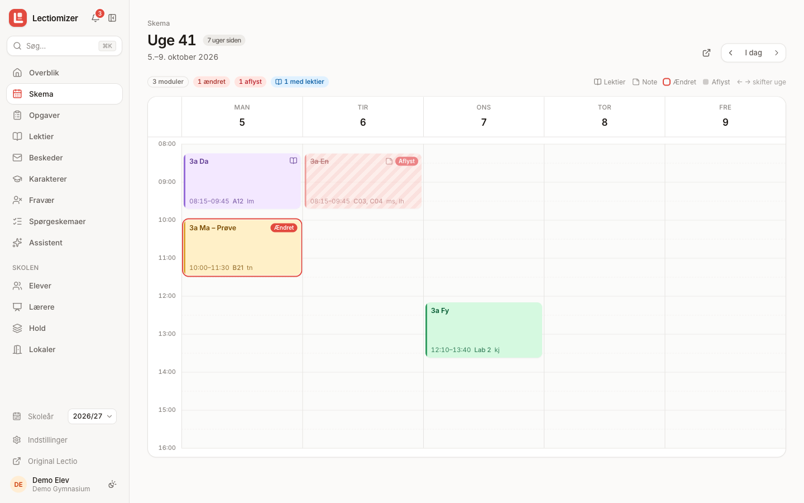<p align="center"><b>Skema</b>: ændrede og aflyste moduler</p></td>
    <td width="50%">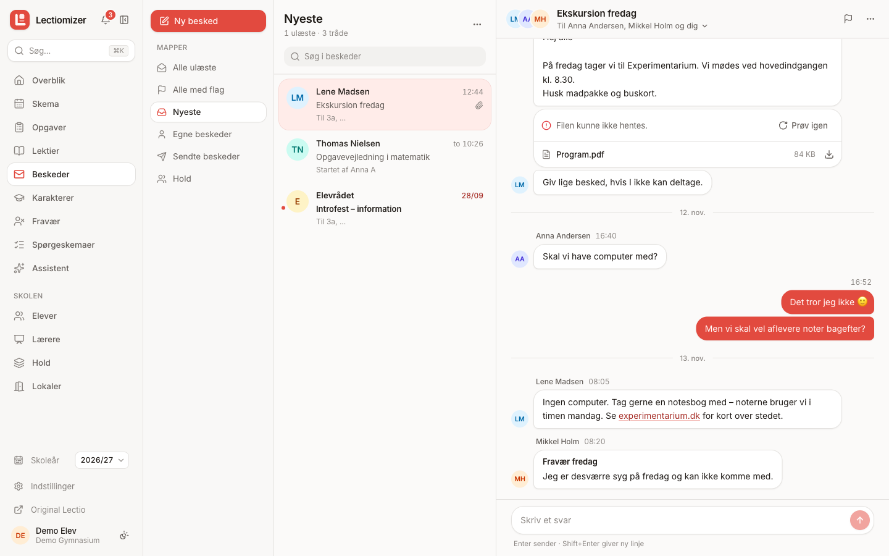<p align="center"><b>Beskeder</b>: samtaletråde og svar</p></td>
  </tr>
  <tr>
    <td>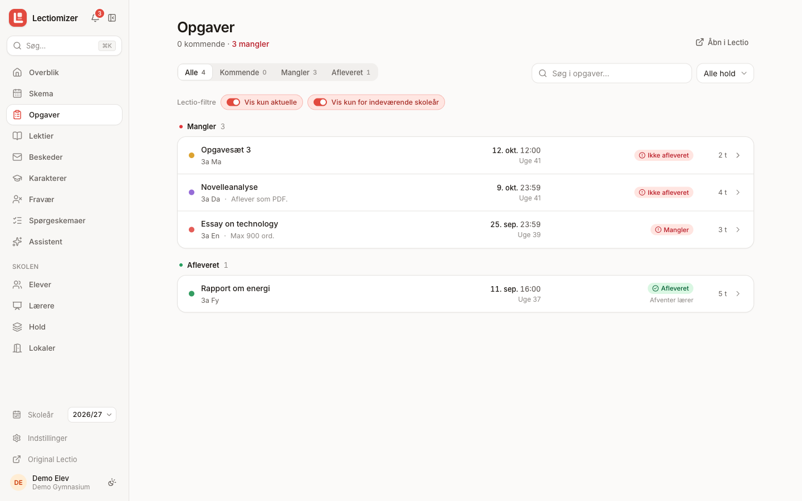<p align="center"><b>Opgaver</b>: manglende og afleverede</p></td>
    <td>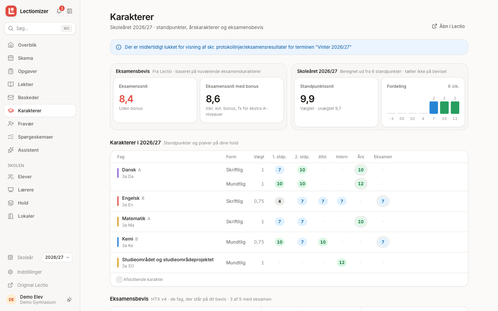<p align="center"><b>Karakterer</b>: snit og fordeling</p></td>
  </tr>
  <tr>
    <td>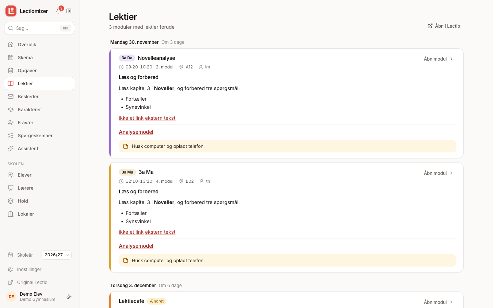<p align="center"><b>Lektier</b>: hele teksten, dag for dag</p></td>
    <td>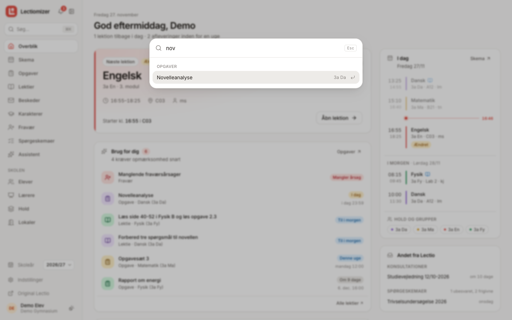<p align="center"><b>Søgning</b>: <code>⌘K</code> overalt</p></td>
  </tr>
  <tr>
    <td>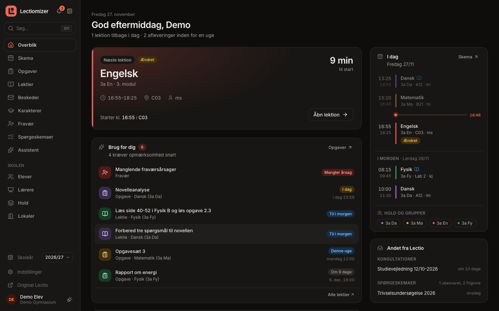<p align="center"><b>Mørkt tema</b></p></td>
    <td>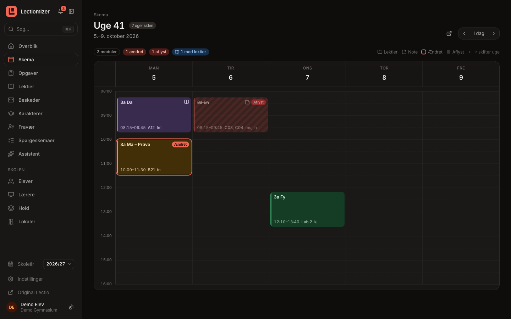<p align="center"><b>Skema i mørkt tema</b></p></td>
  </tr>
</table>

<details>
<summary><b>📱 På mobil</b></summary>
<br>
<p align="center">
  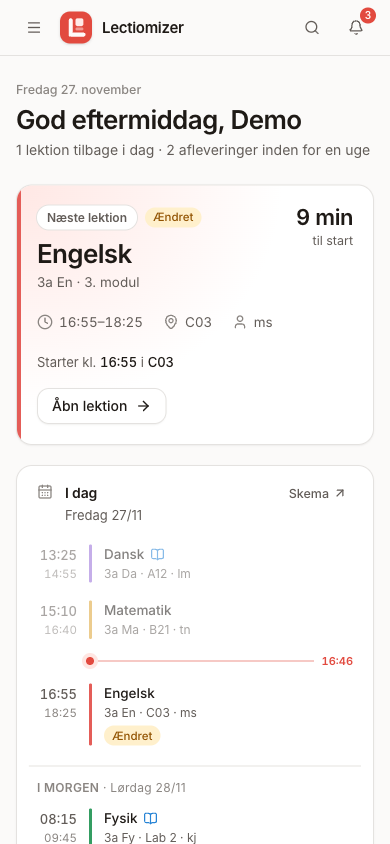
  &nbsp;&nbsp;
  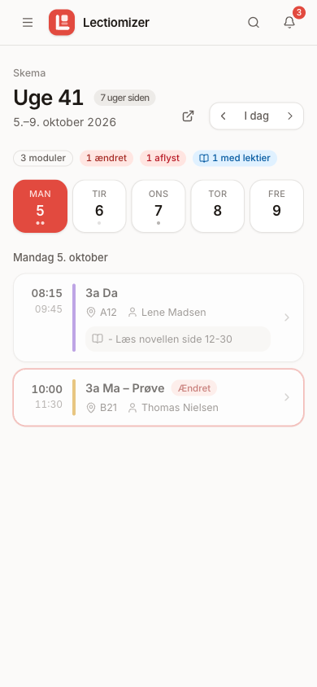
</p>
</details>

## Privatliv

Intet sendes andre steder hen end til:

- **lectio.dk**, med dit eksisterende login;
- **Google Kalender**, kun når du har forbundet den;
- **OpenAI**, kun når du spørger Assistenten om noget;
- **en lokal MCP-klient** på `127.0.0.1`, kun når du slår den til.

Lectiomizer har ingen server og ingen analyse. Læs mere i [privatlivspolitikken](PRIVACY.md) og
[vilkårene](TERMS.md).

## Sådan virker det

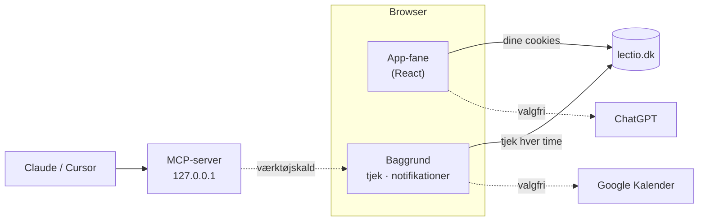

Appen henter Lectio-sider med din session, fortolker dem med rene parsere (`src/lib/lectio/readers/`) og viser
dem i sin egen brugerflade. Se [docs/ARCHITECTURE.md](docs/ARCHITECTURE.md) for detaljerne.

<details>
<summary><b>🔔 Notifikationer</b></summary>

Tjekkene kører i baggrunden, mens browseren er åben, også når Lectiomizer-fanen er
lukket. I Chrome bliver siderne fortolket i et offscreen-dokument; i Firefox i
baggrundssiden. Det første tjek gemmer et stille udgangspunkt; derefter meldes
kun ændringer. Moduler, der er overstået, og opgaver, der allerede er afleveret
eller har passeret fristen, giver ingen besked. Historikken (de seneste 100
notifikationer fra de sidste 90 dage) og øjebliksbillederne gemmes lokalt for
hver elev. Hvis din Lectio-session udløber, viser klokken en "log ind"-besked,
og tjekkene fortsætter, når du har logget ind igen.

</details>

<details>
<summary><b>📆 Google Kalender</b></summary>

Login med Google kræver et OAuth-klient-id, der tilhører dig selv. **Indstillinger →
Google Kalender** guider dig igennem det og viser den omdirigeringsadresse, du skal kopiere:

1. Opret et projekt i [Google Cloud Console](https://console.cloud.google.com/), og aktivér **Google Calendar API**.
2. Under **Google Auth Platform** sætter du samtykkeskærmen op som **External**, lader den blive i **Testing**, tilføjer dig selv som testbruger og tilføjer scopet `https://www.googleapis.com/auth/calendar.app.created`.
3. Opret en OAuth-klient af typen **Web application**, og tilføj omdirigeringsadressen fra Indstillinger som autoriseret redirect-URI. Den er forskellig i Chrome (`https://<extension-id>.chromiumapp.org/`) og Firefox (`https://<hash>.extensions.allizom.org/`).
4. Indsæt klient-id'et i Indstillinger, og tryk på **Forbind Google Kalender**. I Firefox skal du tillade at sende webstedsindhold, når du bliver spurgt.

Du kan også bage et klient-id ind i buildet med `WXT_GOOGLE_CLIENT_ID=…` i `.env`.

Lectiomizer kan kun se og ændre den kalender, den selv opretter. Google-tokenet
gemmes kun i sessionslageret. **Afbryd** tilbagekalder det; "Lectio"-kalenderen
bliver liggende i Google og genbruges, hvis du forbinder igen.

</details>

<details>
<summary><b>✨ Assistent</b></summary>

Åbn **Assistent** i sidebjælken (eller tryk `0`), og vælg **Fortsæt med ChatGPT**. Lectiomizer beder om
tilladelse til at kontakte OpenAI og åbner derefter ChatGPT's login. Svarene bruger dit eget ChatGPT-abonnement;
der skal ingen API-nøgle til. Hvis login-fanen ender på en `127.0.0.1`-side, der ikke kan nås, så indsæt
adressen i feltet under knappen.

Assistenten læser Lectio med særlige, skrivebeskyttede værktøjer (se `src/lib/agent/tool-specs.js`):
`get_overview`, `get_schedule`, `list_assignments`, `get_assignment`, `get_lesson`, `list_messages`,
`read_message`, `get_grades`, `get_absence`, `read_document` og, som nødløsning, `read_page`.
Samtaler gemmes i browseren uden indholdet af det, der blev læst.

</details>

<details>
<summary><b>🔌 MCP-server</b></summary>

`mcp/server.mjs` gør de samme værktøjer tilgængelige for MCP-klienter (Claude Desktop, Claude Code, Cursor, …).
Browseren holder Lectio-sessionen: serveren lytter på `127.0.0.1:47123`, og udvidelsen spørger den om
værktøjskald, så serveren aldrig ser en adgangskode eller cookie. Kræver Node 18+ og har ingen afhængigheder.

1. I Lectiomizer: **Indstillinger → MCP-server → Tillad MCP-klienter**. Kopiér den nøgle, der vises.
2. Tilføj serveren til din klient med nøglen i `LECTIOMIZER_TOKEN`:

   ```bash
   claude mcp add lectio -e LECTIOMIZER_TOKEN=lx_… -- node /sti/til/lectiomizer/mcp/server.mjs
   ```

   ```json
   { "mcpServers": { "lectio": { "command": "node", "args": ["/sti/til/lectiomizer/mcp/server.mjs"], "env": { "LECTIOMIZER_TOKEN": "lx_…" } } } }
   ```

Browseren skal være åben med Lectiomizer installeret og logget ind på Lectio. Udvidelsen leder efter
serveren én gang i minuttet og med det samme, mens der er forbindelse. Flere klienter kan køre hver deres
kopi på samme tid: den første får porten, og de andre sender videre til den. Sæt `LECTIOMIZER_PORT` (og den
samme port i Indstillinger), hvis 47123 er optaget.

</details>

## Udvikling

**Krav:** Node 18+ og npm.

```bash
npm install
npm run dev:app        # appen på http://localhost:5199 med data fra fixtures/ (intet login nødvendigt)
node scripts/gen-fixtures.mjs   # (gen)opret syntetiske fixture-sider
npm run dev            # WXT-udviklingstilstand i Chrome (hot reload)
npm run dev:firefox    # WXT-udviklingstilstand i Firefox
npm test               # vitest
npm run typecheck
```

### Byg og installér

```bash
npm run build           # Chrome  → .output/chrome-mv3
npm run build:firefox   # Firefox → .output/firefox-mv2
npm run zip / zip:firefox
```

- **Chrome**: `chrome://extensions` → slå Udviklertilstand til → *Indlæs upakket* → `.output/chrome-mv3`.
- **Firefox**: `about:debugging#/runtime/this-firefox` → *Indlæs midlertidig tilføjelse* → `.output/firefox-mv2/manifest.json`.

<details>
<summary><b>🚀 Udgivelse</b></summary>

Udgivelser bygges lokalt og offentliggøres på [GitHub Releases](https://github.com/Turtlezztz/lectiomizer-extension/releases).
Elever henter Firefox- og Chrome-versionen derfra; Chrome-versionen ligger også i [Chrome Web Store](https://chromewebstore.google.com/detail/lectiomizer/bcjodfpidkofibnfmdobgdmgdelekhdc).

1. Læg dine API-nøgler til addons.mozilla.org ([hent dem her](https://addons.mozilla.org/developers/addon/api/key/)) i `.env`:
   `AMO_JWT_ISSUER=user:…` og `AMO_JWT_SECRET=…`. Tilføj eventuelt `CHROME_WEB_STORE_URL=…` for at linke til butikssiden i udgivelsesnoterne.
2. Hæv `version` i `package.json`, commit det (`Release x.y.z`), og kør så:

```bash
npm run release              # typecheck, test, byg, signér Firefox, tag vX.Y.Z, udgiv
npm run release -- --draft   # gem udgivelsen som kladde, så du kan rette noterne først
npm run release -- --xpi signed.xpi   # brug en XPI, du allerede har signeret, i stedet for at signere igen
```

Firefox-versionen signeres på AMO som en *unlisted* (selvdistribueret) version, fordi Firefox kun installerer
signerede tilføjelser. Udgivelsen får den signerede `.xpi`, Chrome-`.zip`'en, kildekode-zip'en og `updates.json`,
som Firefox-manifestets `update_url` læser, så installerede kopier opdaterer sig selv.

</details>

### Projektstruktur

```
src/
  entrypoints/   app-siden, baggrunden og (Chrome) offscreen-dokumentet
  app/           skal: routes, sidebjælke, søgning, onboarding
  features/      én mappe pr. side (Overblik, Skema, Opgaver, …)
  lib/lectio/    fetch, postbacks og rene parsere af Lectio-sider
  lib/sync/      baggrundstjek, notifikationer og Google Kalender
  lib/agent/     Assistenten og MCP-broen
mcp/             den lokale MCP-server (ingen afhængigheder)
tests/           vitest
```

## Stjernehistorik

<a href="https://star-history.com/#Turtlezztz/lectiomizer-extension&Date">
  <picture>
    <source media="(prefers-color-scheme: dark)" srcset="https://api.star-history.com/svg?repos=Turtlezztz/lectiomizer-extension&type=Date&theme=dark">
    
  </picture>
</a>

---

<div align="center">
<sub>Lectiomizer er et uafhængigt projekt og er ikke tilknyttet eller godkendt af Lectio eller Macom.</sub>
</div>
